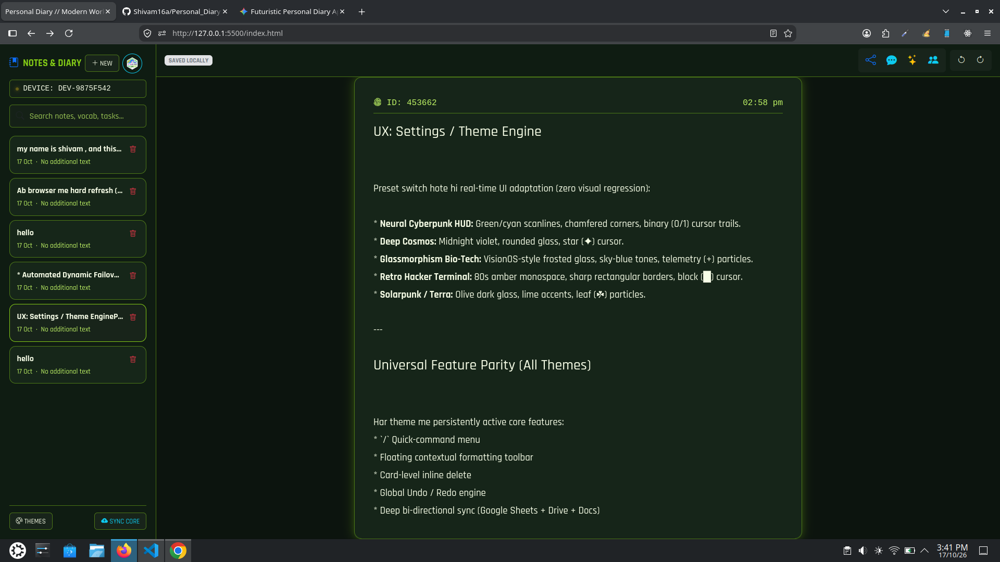

# Personal Diary & Real-Time Collaborative Workspace

A feature-rich, multi-theme personal diary and collaborative productivity web application designed with real-time peer-to-peer communication, cloud synchronization, and modular ES6 architecture.

---

## 📸 Screenshots & Interface Preview

> *Here you can showcase the visual interface of your application across different themes and views.*

### 1. Main Dashboard & Editor View

*Description: The clean, responsive main interface featuring the sidebar note list, device telemetry status, and the primary rich-text editing canvas.*

### 2. Direct Messenger & Friend Network

*Description: The right-side drawer containing the 1-on-1 real-time messaging system, unread badge counters, and friend discovery search.*

### 3. Multi-Theme Adaptation (Cyberpunk & Light Modes)

*Description: Demonstrating WCAG AAA compliant text contrast switching across various custom themes such as Neural Cyberpunk, Retro Hacker, and Modern Light.*

---

## 📖 Project Overview
cyberChronicle Diary is a sophisticated client-side web application that merges private journaling with decentralized, real-time collaboration tools. Built using native ES6 modules without heavy framework overhead, it provides an ultra-fast, highly customizable environment where users can manage rich text notes, collaborate live via WebRTC rooms, sync data securely with Google Apps Script cloud backends, and communicate instantly through an encrypted direct messaging pipeline.

---

## 🗂️ Project Directory Structure & Architecture

The application follows a clean, modular component-driven architecture:

```text
.
├── css
│   ├── animations.css       # Fluid UI animations, pulse glows, and modal transitions
│   ├── style.css            # Core layout styles, responsive grids, and docked chat bars
│   └── themes.css           # CSS Custom Properties for multi-theme color variables
├── index.html               # Single-page application markup shell
├── js
│   ├── aiAssistant.js       # AI-powered text generation and summarization tools
│   ├── app.js               # Central application initializer and event controller
│   ├── chatRoom.js          # Room-based WebRTC real-time note collaboration engine
│   ├── cloudSync.js         # Google Apps Script and Google Drive synchronization handler
│   ├── db.js                # IndexedDB and LocalStorage persistence layer
│   ├── directMessenger.js   # 1-on-1 P2P WebRTC chat, friendship handshakes, and de-duplication
│   ├── editor.js            # Rich-text editor core, formatting, and DOM selection handlers
│   ├── imageEditor.js       # Canvas-based image cropping, resizing, and doodling suite
│   ├── networkRelay.js      # Background inbox polling, audio chimes, and OS push notifications
│   ├── profile.js           # User identity, avatar management, and public directory lookup
│   ├── reminders.js         # Task tracking and reminder notification management
│   ├── share.js             # Secure short-link generation and note sharing manager
│   ├── slashMenu.js         # Command palette (`/`) for inserting structured blocks
│   ├── themes.js            # Theme switcher controller and persistence manager
│   └── voiceVideo.js        # WebRTC media streaming utilities
├── manifest.json            # PWA web manifest configuration
├── README.md                # Project documentation
└── sw.js                    # Service Worker for offline caching and background push alerts

```

---

## 🚀 Core Features & Deep Technical Explanation

### 1. Advanced Note Editor & Slash Commands (`editor.js`, `slashMenu.js`)

* **Rich Text Formatting:** Supports bold, italics, highlights, blockquotes, and dynamic HTML tables.
* **Command Palette:** Typing `/` triggers an interactive popup menu allowing users to insert structured blocks, media, or tables instantly.
* **Canvas Annotations (`imageEditor.js`):** Integrated image cropping, filters, and full-screen drawing tools built directly on HTML5 Canvas.

### 2. Hybrid Real-Time 1-on-1 Messenger (`directMessenger.js`, `networkRelay.js`)

* **PeerJS WebRTC Mesh:** Establishes direct peer-to-peer data connections between devices for instant message delivery without central server bottlenecks.
* **Cloud Inbox Fallback:** Integrated with a Google Apps Script backend (`cloudSync.js`) that acts as an asynchronous relay when peers are offline.
* **De-duplication Engine:** Implements unique cryptographic message IDs (`msgId`) and memory sets to completely eliminate duplicate message rendering across overlapping P2P and cloud streams.
* **Interactive Chat Tools:** Supports quoted replies, emoji reaction pickers, unread counter badges, and direct sharing of collaborative note cards.

### 3. Multi-Theme Dynamic Engine (`themes.css`, `themes.js`)

* **WCAG AAA Compliance:** Engineered with rigorous contrast checks to ensure text visibility across both dark cyberpunk aesthetics and bright daylight modes.
* **Preset Themes:** Includes *Default Clean Light*, *Neural Cyberpunk HUD*, *Deep Cosmos & Nebula*, *Glassmorphism Bio-Tech*, *Retro Hacker Terminal (Amber)*, and *Solarpunk Bio-Core*.

---

## ⚙️ Installation & Local Development

To set up and run this project locally, execute the following commands in your terminal:

1. **Clone the Repository:**
```bash
git clone https://github.com/Shivam16a/Personal_Diary.git
cd Personal_Diary

```


2. **Access in Browser:**
Open your web browser and go to:
```text
[http://127.0.0.1:5500](http://127.0.0.1:5500)

```


---

## 📜 License

This project is open-source and available under the [MIT License](https://www.google.com/search?q=LICENSE).
